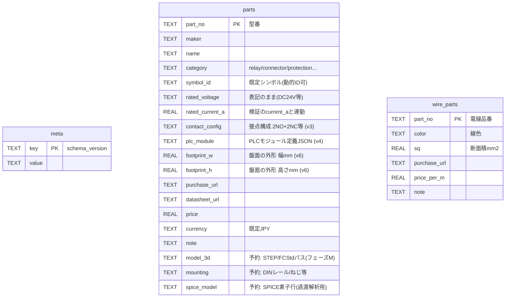

# データ設計書

作成: 2026-08-21。更新: 2026-08-23(フェーズ6: `.mdkproj` format_version 7・`Sheet.annotation_text_mm`。M4フェーズ4: format_version 6・盤レイアウトの4エンティティ+凡例表・`Sheet.kind`・`Project.frame_template`・部品DB スキーマv6)。実装の正は`madake-core/src/model.rs`(ドキュメント)と`madake-core/src/parts.rs`(部品DB)。

MadakeCADの永続データは3系統ある:

| データ | 形式 | 場所 | マスタ権 |
|---|---|---|---|
| 図面ドキュメント | `.mdkproj`(整形JSON) | ユーザーが選ぶパス | 図面の全て(自己完結) |
| 部品DB | SQLite | アプリデータdir `MadakeCAD/parts.sqlite`(`MADAKE_PARTS_DB`で変更可) | 部品・電線品番のマスタ |
| チャット履歴 | `<プロジェクト名>.chat.json` | `.mdkproj`の隣 | AI会話 |

## 1. 図面ドキュメント(.mdkproj)

`format_version: 7`。構造(mermaid classDiagram):

```mermaid
classDiagram
    Project "1" *-- "1..*" Sheet
    Project "1" *-- "*" WirePart : wire_partsスナップショット
    Project "1" *-- "*" PlcAssignment : plc_assignments
    Sheet "1" *-- "1" TitleBlock
    Sheet "1" *-- "*" Revision
    Sheet "1" *-- "*" Entity : entities(BTreeMap[Uuid,Entity])
    Entity <|-- SymbolInstance
    Entity <|-- Wire
    Entity <|-- Junction
    Entity <|-- NetLabel
    Entity <|-- TextEntity
    Entity <|-- Harness
    Entity <|-- PanelOutline
    Entity <|-- DinRail
    Entity <|-- Duct
    Entity <|-- Footprint
    Entity <|-- PanelLegend

    class Project {
      format_version: u32
      name: String
      frame_template: String?  %% 図枠テンプレートid。未指定=jis-a3
    }
    class Sheet {
      id: Uuid
      name: String
      kind: schematic|panel   %% 既定=schematic
      size: A4|A3|A2|A1|A0
      orientation: Landscape|Portrait
      zone_cols / zone_rows: u32
      annotation_text_mm: f64?  %% 注記文字高。未設定=2.0mm
    }
    class TitleBlock {
      company / title / drawing_no / scale / date
      designed / drawn / checked / approved / rev
    }
    class Revision {
      mark / date / description / by
    }
    class SymbolInstance {
      id: Uuid
      symbol_id: String  %% 静的id / ユーザーシンボル / connector_{n}p等の動的id
      at: Point(mm)
      rotation: 0|90|180|270
      mirror: bool
      reference: String  %% "K1"
      value: String      %% 型番
      attrs: Map~String,String~  %% current_a / jumpers / block_pins等
    }
    class Wire {
      id: Uuid
      points: Point[]    %% 直交ポリライン
      color: String
      sq: f64            %% mm2
      length_m: f64?
      part_no: String?
      net: String?
    }
    class Junction { id; at: Point }
    class NetLabel { id; at: Point; name; rotation; attrs %% tag=left|right }
    class TextEntity { id; at: Point; text; height; rotation; anchor; color?; bold }
    class Harness { id; points: Point[]; name; note }
    class PanelOutline { id; at: Point; w; h; name %% 取付板は外周から10mm内側 }
    class DinRail { id; y %% 取付線(帯の中心); x1; x2 }
    class Duct { id; at: Point; w; h }
    class Footprint {
      id; at: Point %% 描かれる矩形の左上
      w; h          %% 回転前の部品寸法(部品DBのfootprint_w/h)
      rotation: 0|90
      reference; part_no
      item_no: u32? %% バルーン番号。Noneなら未採番
    }
    class PanelLegend { id; at: Point  %% 行は描画のたびに導出 }
```

規約:

- 座標は**mm・左上原点・Y下向き**。ピン/端点は2.5mmグリッド上(接続判定の許容誤差0.01mm)
- Entityは`kind`タグ付きJSON(serde tagged enum)
- **編集は必ずCommand経由**(add_entity / update_entity / remove_entity / move_entities / add_sheet / set_title_block / set_frame_template / renumber_panel_items 等)。Commandスキーマの正は`madake-core/src/command.rs`(MCPの`execute_commands`入力スキーマとして自動公開)
- 盤レイアウトの5エンティティ(`panel_outline`/`din_rail`/`duct`/`footprint`/`panel_legend`)は**専用コマンドを持たない**。既存のadd/update/move/deleteに相乗りするのでundoもそのまま効く。唯一の例外がバルーン採番`renumber_panel_items`(逆コマンド=`set_panel_item_numbers`)
- **シート種別のガードはUIだけが持つ**。Commandエンジンは盤シートへ配線を置くことを拒まない
- 図面はシンボル定義の**スナップショットを持たない**(`SymbolInstance`は`symbol_id`だけ)。ユーザーシンボルを保存し直すと配置済みの部品も新しい定義で描き直される
- 派生データ(保存されない): ネットリスト・SPICEデッキ・診断・シミュレーション結果・盤の未配置部品リストは都度計算

### format_versionの履歴

| 版 | 変更 | 旧ファイルの扱い |
|---|---|---|
| 1 | 初版 | — |
| 2 | `Project.plc_assignments`(PLC I/O割付表) | 空の表で開く |
| 3 | `Project.frame_template`(図枠テンプレートid) | 既定の`jis-a3`で開く |
| 4 | `Sheet.kind`(回路図/盤レイアウト)+盤エンティティ4種 | 回路図シートとして開く |
| 5 | `TextEntity.anchor`/`color`/`bold`(注記の装飾) | 左揃え・黒・細字で開く |
| 6 | `Footprint.item_no`+凡例表エンティティ`panel_legend` | バルーン未採番として開く。**逆に新しいファイルは旧アプリでは読めない**(`panel_legend`が未知) |
| 7 | `Sheet.annotation_text_mm`(注記文字高。配線注記・線番・ネットタグの大きさ) | 既定の2.0mm=従来の見た目で開く |

`NetLabel.attrs`(方向付きタグ形状)のように**追加するだけで旧アプリも読める**変更は版を上げていない。
版を上げるのは、旧アプリが読めなくなる要素が入ったとき(6)と、意味のある新フィールドを足したときだけ。

### 図枠テンプレート(`.mdkproj`の外)

`Project.frame_template`はidの参照だけを持ち、実体は同梱(`src-tauri/resources/frame_templates/*.json`)かユーザー
(`~/MadakeCAD/templates/frames/*.json`)のJSON。`{ id, name(_ja), paper{w,h}, frame_margin, zones{cols,rows,col_labels,row_labels},
title_block{origin,w,h,row_h,grid_lines[],cells[{x,y,w,h,text|bind,size,align,weight,omit_if_empty}]}, revision_block{rows_max,col_w[]}, logo? }`。
セルは`text`(固定文字)か`bind`(バインド入り)のどちらか一方で、知らないバインドは空文字になる。
**用紙とゾーン分割はテンプレートで変わらない**(シートが正)。

### ユーザーシンボルライブラリ(`.mdkproj`の外)

`~/MadakeCAD/symbols/{id}.json`(env `MADAKE_USER_SYMBOLS_PATH`で差し替え可)に`SymbolDef`のJSONそのまま。
分類は読み書きとも`user`へ正規化し、同梱・動的シンボルとのid衝突は拒否する(解決順=同梱→動的→ユーザー)。
Commandエンジンの外(ファイルのドメイン)なので、保存・削除は`doc:patch`にもundo履歴にも乗らない。

## 2. 部品DB(parts.sqlite)

`schema_version: 6`(metaテーブルで管理。旧バージョンは起動時にマイグレーション)。



- partsとwire_partsに外部キー関係はない(図面側は型番文字列で参照するスナップショット方式。DBを消しても図面は自己完結)
- 新規作成時のみサンプル(ダミー型番 MDK-*)を投入
- 図面との連携: 部品挿入ダイアログで選択→`SymbolInstance.value=part_no`、`attrs.current_a=rated_current_a`、`attrs.contact_config=contact_config`
- 盤レイアウトとの連携: 未配置部品を置くとき`footprint_w`/`footprint_h`を型番で引く。**両方が正の値のときだけ**寸法として使い、そうでなければ既定の20×40mm
- マイグレーションの版: v2=`spice_model` / v3=`contact_config` / v4=`plc_module` / v5=PLCサンプルの追補(列は変えない) / v6=`footprint_w`・`footprint_h`+同梱サンプルへの寸法追補。**列の追加を全部済ませてからデータ追補へ進む**(部品の読み書きが現行の全列を並べるため)

## 3. チャット履歴(.chat.json)

`format_version`付き。会話の配列(各会話: id・タイトル・messages)。メッセージはターンごとに
`applied_undo_depth`(そのターンでドキュメントに積まれたundo段数)を持ち、「ターンを元に戻す」はundo N回と等価。
詳細は`madake-agent`クレートと`docs/superpowers/plans/2026-08-20-phaseA1-ai-chat-and-cli.md`。

## 4. 派生データの型(保存されない)

| 型 | 生成元 | 用途 |
|---|---|---|
| `Net { name, pins[], wire_ids[] }` | netlist.rs | BOM/電線リスト/検証/表示 |
| `Diagnostic { severity, code, message, sheet_id, entity_ids }` | verify.rs | 検証結果パネル・CLI・MCP |
| `SpiceDeck` | spice.rs | ngspice入力(ワイヤ=抵抗、ノード=接続点クラスタ) |
| `SimOpResult { voltage, nets[], components[] }` | sim.rs | シミュレーション結果パネル |
| `ImportReport` | kicad.rs | KiCadインポートの要約 |
| `Patch { revision, ops[] }` | command.rs | UI/クライアントへの差分配信(SSE `/api/v1/events`・Tauri `doc:patch`) |
