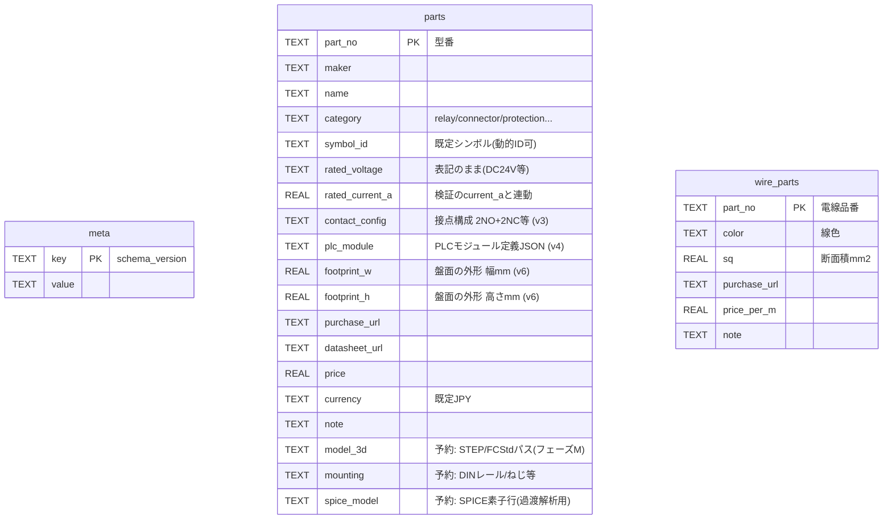

# データ設計書

作成: 2026-08-21。更新: 2026-11-16(線番を描かない設定と字の横の伸縮率: format_version 26・`Sheet.hide_wire_numbers`・`TextFont.stretch`/`TextEntity.stretch`、ユーザーシンボルの `free_pins`、シンボル定義の `net`)。その前の更新: 2026-11-16(線と文字の描き方: format_version 25・`Sheet.symbol_weight_mm`/`vivid_wire_colors`・`Wire.dashed`/`weight_mm`・`Shape.arrow_end`・`TextFont.pen_mm`・`attrs`の`block_leads`/`caption_layout`)。その前の更新: 2026-11-15(シートの配線の描き方とブロックの参照記号の位置: format_version 24・`Sheet.wire_weight_mm`/`hide_wire_notes`・`attrs`の`block_caption`、注記の回転の描画)。その前の更新: 2026-11-15(ブロックの貫通ピン: format_version 23・向かい合う辺に同じピン番号を1回ずつ)。その前の更新: 2026-11-15(ブロックの細かいピン間隔: format_version 22・`attrs`の`block_pitch`/`block_numbers`)。その前の更新: 2026-11-15(プロジェクトの書体: format_version 21・`Project.text_font`、図枠テンプレートの`text_latin`と`cells[].spacing`)。その前の更新: 2026-10-15(盤の銘板・寸法線: format_version 16・`Entity::Nameplate`/`Entity::Dimension`。同日に多芯ケーブル: format_version 15・`Entity::Cable`。同日にPLC I/O図面の生成設定のプロジェクト保存: format_version 14・`Project.plc_generate`)。その前の更新: 2026-09-28(整えバリアントの複製シートの印: format_version 13・`Sheet.variant_of`)。その前: 2026-09-28(クラウド側のFreeCAD連携M5-1〜3を統合: format_version 12・`Project.mech_links`・`MechLink.placement`・`Wire.length_source`。クラウド側の暫定番号3/4はこの12へ畳んだ)。フェーズ6タスク6: format_version 11・電線品番凡例ブロックエンティティ`WireLegend`(G9残)。フェーズ6タスク5: `.mdkproj` format_version 10・`Project.no`(G16、プロジェクト番号)。フェーズ6タスク4: format_version 9・`TextEntity.leader_to`(G20、注記の引き出し線)。フェーズ6: format_version 8・図形エンティティ`Shape`(G10)、format_version 7・`Sheet.annotation_text_mm`。M4フェーズ4: format_version 6・盤レイアウトの4エンティティ+凡例表・`Sheet.kind`・`Project.frame_template`・部品DB スキーマv6)。実装の正は`madake-core/src/model.rs`(ドキュメント)と`madake-core/src/parts.rs`(部品DB)。

MadakeCADの永続データは3系統ある:

| データ | 形式 | 場所 | マスタ権 |
|---|---|---|---|
| 図面ドキュメント | `.mdkproj`(整形JSON) | ユーザーが選ぶパス | 図面の全て(自己完結) |
| 部品DB | SQLite | アプリデータdir `MadakeCAD/parts.sqlite`(`MADAKE_PARTS_DB`で変更可) | 部品・電線品番のマスタ |
| チャット履歴 | `<プロジェクト名>.chat.json` | `.mdkproj`の隣 | AI会話 |

## 1. 図面ドキュメント(.mdkproj)

`format_version: 26`(旧版は既定値で開ける。版ごとの変更は下の履歴表)。構造(mermaid classDiagram):

```mermaid
classDiagram
    Project "1" *-- "1..*" Sheet
    Project "1" *-- "*" WirePart : wire_partsスナップショット
    Project "1" *-- "*" PlcAssignment : plc_assignments
    Project "1" *-- "*" MechLink : mech_links(FreeCAD対応付け)
    MechLink "1" *-- "0..1" MechPlacement : placement
    Sheet "1" *-- "1" TitleBlock
    Sheet "1" *-- "*" Revision
    Sheet "1" *-- "*" Entity : entities(BTreeMap[Uuid,Entity])
    Entity <|-- SymbolInstance
    Entity <|-- Wire
    Entity <|-- Junction
    Entity <|-- NetLabel
    Entity <|-- TextEntity
    Entity <|-- Harness
    Entity <|-- PanelOutline
    Entity <|-- DinRail
    Entity <|-- Duct
    Entity <|-- Footprint
    Entity <|-- PanelLegend
    Entity <|-- WireLegend

    class Project {
      format_version: u32
      name: String
      no: String?  %% プロジェクト番号(G16)。表題欄バインド{project.no}の供給元。未設定=空
      frame_template: String?  %% 図枠テンプレートid。未指定=jis-a3
      text_font: TextFont?  %% 書体 {id, latin: half|full}。未設定=システムの書体
    }
    class Sheet {
      id: Uuid
      name: String
      kind: schematic|panel   %% 既定=schematic
      size: A4|A3|A2|A1|A0
      orientation: Landscape|Portrait
      zone_cols / zone_rows: u32
      annotation_text_mm: f64?  %% 注記文字高。未設定=2.0mm
      wire_weight_mm: f64?  %% 配線の線の太さ。未設定=0.35mm (0.18〜1.0)
      hide_wire_notes: bool  %% 配線注記 (線径・色名・長さ) を描かない。未設定=描く
    }
    class TitleBlock {
      company / title / drawing_no / scale / date
      designed / drawn / checked / approved / rev
    }
    class Revision {
      mark / date / description / by
    }
    class SymbolInstance {
      id: Uuid
      symbol_id: String  %% 静的id / ユーザーシンボル / connector_{n}p等の動的id
      at: Point(mm)
      rotation: 0|90|180|270
      mirror: bool
      reference: String  %% "K1"
      value: String      %% 型番
      attrs: Map~String,String~  %% current_a / jumpers / block_pins / block_size / block_pitch / block_numbers等。ブロックのピン番号は、向かい合う辺(左と右、上と下)に1回ずつだけ重ねられる(貫通ピン。両側は同じ名前で、接点・コネクタの絵は付けない。片側だけの配線も未接続とはしない。同じ辺・隣り合う辺・3回目は重複として断る)
    }
    class Wire {
      id: Uuid
      points: Point[]    %% 直交ポリライン
      color: String
      sq: f64            %% mm2
      length_m: f64?
      length_source: manual|freecad  %% 長さの出所(M5-2)
      part_no: String?
      net: String?
    }
    class MechLink {
      entity_id: Uuid     %% シンボル/配線のid。FreeCAD側はmadake_idプロパティ
      fcstd_path: String
      object_name: String
      synced_at: String   %% ISO 8601
      placement: MechPlacement?  %% FreeCAD側の配置 x_mm/y_mm/z_mm/rotation_deg (M5-3)
    }
    class Junction { id; at: Point }
    class NetLabel { id; at: Point; name; rotation; attrs %% tag=left|right }
    class TextEntity { id; at: Point; text; height; rotation; anchor; color?; bold; leader_to: Uuid? %% G20、対象エンティティid }
    class Harness { id; points: Point[]; name; note  %% 電線をまとめる境界専用 }
    class Shape {
      id
      shape: rect|line|circle|polyline
      points: Point[]  %% rect=対角2点 / line=両端2点 / circle=中心+円周上の1点 / polyline=N点
      stroke: String   %% 色トークン(注記と共有)
      stroke_width_mm: f64  %% 0.1〜2.0
      fill: String?    %% 色トークン。Noneなら塗らない(塗りは不透明度0.15)
      dashed: bool
    }
    class PanelOutline { id; at: Point; w; h; name %% 取付板は外周から10mm内側 }
    class DinRail { id; y %% 取付線(帯の中心); x1; x2 }
    class Duct { id; at: Point; w; h }
    class Footprint {
      id; at: Point %% 描かれる矩形の左上
      w; h          %% 回転前の部品寸法(部品DBのfootprint_w/h)
      rotation: 0|90
      reference; part_no
      item_no: u32? %% バルーン番号。Noneなら未採番
    }
    class PanelLegend { id; at: Point  %% 行は描画のたびに導出 }
    class WireLegend { id; at: Point  %% 回路図シート専用。行(線色/sq/品番/使用長)は描画のたびにシートの配線から導出 }
```

規約:

- 座標は**mm・左上原点・Y下向き**。ピン/端点は2.5mmグリッド上(接続判定の許容誤差0.01mm)
- Entityは`kind`タグ付きJSON(serde tagged enum)
- **編集は必ずCommand経由**(add_entity / update_entity / remove_entity / move_entities / add_sheet / set_title_block / set_frame_template / renumber_panel_items 等)。Commandスキーマの正は`madake-core/src/command.rs`(MCPの`execute_commands`入力スキーマとして自動公開)
- 図形`shape`は**電気的な意味を持たない**。ネットリスト・ERC・部品表・From-To電線リスト・整頓メトリクスのどれからも構造的に除外される(筐体の囲みはこれで描き、ハーネス境界は電線のグルーピング専用に保つ = G11)。線色・塗り色は注記と同じ色トークンだけで、生の色コードはCommandエンジンが拒否する
- 盤レイアウトの5エンティティ(`panel_outline`/`din_rail`/`duct`/`footprint`/`panel_legend`)は**専用コマンドを持たない**。既存のadd/update/move/deleteに相乗りするのでundoもそのまま効く。唯一の例外がバルーン採番`renumber_panel_items`(逆コマンド=`set_panel_item_numbers`)
- 電線品番凡例ブロック`wire_legend`(G9残)も同様に**専用コマンドを持たない**回路図シート専用エンティティ。`panel_legend`と対で、中身(線色・sq・電線品番・使用長合計)は持たずシートの配線から描画のたびに導出する(`madake-core/src/wire_legend.rs`)。ネットリスト・ERC・部品表・From-To電線リストのどれからも構造的に除外される(図形`shape`と同じ扱い)
- **シート種別のガードはUIだけが持つ**。Commandエンジンは盤シートへ配線を置くことを拒まない
- 図面はシンボル定義の**スナップショットを持たない**(`SymbolInstance`は`symbol_id`だけ)。ユーザーシンボルを保存し直すと配置済みの部品も新しい定義で描き直される
- 派生データ(保存されない): ネットリスト・SPICEデッキ・診断・シミュレーション結果・盤の未配置部品リストは都度計算

### format_versionの履歴

| 版 | 変更 | 旧ファイルの扱い |
|---|---|---|
| 1 | 初版 | — |
| 2 | `Project.plc_assignments`(PLC I/O割付表) | 空の表で開く |
| 3 | `Project.frame_template`(図枠テンプレートid) | 既定の`jis-a3`で開く |
| 4 | `Sheet.kind`(回路図/盤レイアウト)+盤エンティティ4種 | 回路図シートとして開く |
| 5 | `TextEntity.anchor`/`color`/`bold`(注記の装飾) | 左揃え・黒・細字で開く |
| 6 | `Footprint.item_no`+凡例表エンティティ`panel_legend` | バルーン未採番として開く。**逆に新しいファイルは旧アプリでは読めない**(`panel_legend`が未知) |
| 7 | `Sheet.annotation_text_mm`(注記文字高。配線注記・線番・ネットタグの大きさ) | 既定の2.0mm=従来の見た目で開く |
| 8 | 図形エンティティ`shape`(矩形・線・円・折れ線。電気的意味なし) | 図形が無いだけでそのまま開く。**逆に図形を含む新しいファイルは旧アプリでは読めない**(`shape`が未知) |
| 9 | `TextEntity.leader_to`(G20、注記から対象エンティティへの引き出し線) | 引き出し先未設定(`None`)として開く=引き出し線を描かない |
| 10 | `Project.no`(G16、プロジェクト番号。表題欄バインド`{project.no}`の供給元) | 番号未設定(`None`)として開く=バインドは空欄のまま(見た目は従来どおり) |
| 11 | 電線品番凡例ブロックエンティティ`wire_legend`(G9残。`panel_legend`の回路図版) | 凡例ブロックが無いだけでそのまま開く。**逆に凡例ブロックを含む新しいファイルは旧アプリでは読めない**(`wire_legend`が未知) |
| 12 | FreeCAD連携(M5): `Project.mech_links`+`MechLink.placement`+`Wire.length_source`。クラウド側が同時期に別系統で付けた暫定版3・4をこの1版へ畳んだもの | 対応付けが無いファイルは空の対応付けで開き、配線の長さは全て手入力扱い(`manual`)。クラウド側の暫定版(`format_version: 3`/`4`)のファイルも、`mech_links`と`length_source`をそのまま保って12へ更新される |
| 13 | 整えバリアントの複製シートの印`Sheet.variant_of`(元シートのid。`None`なら普通のシート) | 印の無いファイルのシートはすべて普通のシート(`None`)として開き、クロスリファレンスの数え方も出力する図面も変わらない。印はnoneのとき書き出さない(`skip_serializing_if`)ので、複製シートを持たない新しいファイルは旧アプリでも読める |
| 14 | PLC I/O図面の生成設定`Project.plc_generate`(ラダー形式・ラング間隔・先頭スキップ・配置方針・分割の単位。生成ダイアログの「プロジェクトに保存」) | 設定の無いファイルは保存なし(`None`)として開き、生成ダイアログは既定値から始まる |
| 15 | 多芯ケーブル`cable`エンティティ(定義線2点・参照記号・型番・芯数・線径・芯線割当`cores[{core,color,wire}]`・シールド・長さ) | ケーブルが無いだけでそのまま開く。**逆にケーブルを含む新しいファイルは旧アプリでは開けない**(未知のエンティティ種別) |
| 16 | 盤の銘板`nameplate`エンティティ(結び付くフットプリント・位置・大きさ・行・文字高・上下・説明追従・型番)と寸法線`dimension`エンティティ(端点`a`/`b`=点かフットプリント・向き・線の位置) | 銘板・寸法線が無いだけでそのまま開く。**逆にそれらを含む新しいファイルは旧アプリでは開けない**(未知のエンティティ種別) |
| 20 | 改訂行の改訂番号・承認・個数(`Revision.rev_no` / `approved` / `count`)と、表題欄の自由な欄(`TitleBlock.fields`: 名前→値。図枠テンプレートは`{field.名前}`でバインドする。名前は a-z・0-9・_ の1〜32文字) | 新しい項目が空で開く。空の項目は書き出さない(`skip_serializing_if`)ので、使っていないファイルは版番号以外これまでと同じ。形式19のアプリは版番号で断る |
| 21 | プロジェクトの書体`Project.text_font`(`{id, latin}`。`id`は同梱のストロークフォント、いまは`kst32b`だけ。`latin`は英数字を半角`half`(既定)か全角`full`のどちらの字で描くか)。`set_text_font`コマンドで設定し、同梱していないidは断る | 書体未設定(`None`)で開く=システムの書体で従来どおりに描く。未設定のときは書き出さない(`skip_serializing_if`)ので、書体を選んでいないファイルは版番号以外これまでと同じ。形式20のアプリは版番号で断る |
| 22 | ブロックの細かいピン間隔。ブロックシンボルの`attrs`に`block_pitch`(`"5"`が既定、`"2.5"`でピン間隔2.5mm・大きさの刻み2.5mm・最小5×5mm。ピンn本の辺は(n+1)×2.5mm以上。外形とピンの列は、ピンと辺が2.5mmの格子に乗るよう必要に応じて1.25mmずらす。コネクタの絵は使えない)と`block_numbers`(`"outside"`が既定、`"inside"`でピン番号を外形の内側に描き、ピン名は描かない。コネクタの絵は使えない)を足した。それ以外の値は断る | 新しいデータ型は無く、属性が無いブロックは従来どおり(5mm間隔・番号は外側)に開く。使っていないファイルは版番号以外これまでと同じ。KiCad・DXFの書き出しと取り込みは属性を保つ。**形式21のアプリは版番号で断る** |
| 23 | ブロックの貫通ピン。ブロックのピン表で、同じピン番号を向かい合う辺(左と右、または上と下)に1回ずつ置ける。2つの接続点は1つのノードで(ネットリストの貫通端子の規則)、ネットのピン一覧には1回だけ載る。両側のピン名は前後の空白を除いて同じにし、どちらにも`contacts`・`connector`は付けない。同じ辺に2回・隣り合う辺・3回以上は従来どおり重複として断る。`REF.NO`は曖昧で、`REF.NO#1`・`REF.NO#2`はブロックのピン表の定義順(左・右・上・下の順。回転・反転の前なので、反転したブロックでは`#1`が画面の右に描かれる)。片側にだけ配線がある貫通ピンも、未接続ピンの検査(ERC)では接続済みとして数える(貫通端子と同じ)。`block_numbers`が`"inside"`で、2本が同じ線上に並ぶ組は、その線と交わる辺(左右の組なら上下、上下の組なら左右)にピンが無いときだけ、番号を箱の中央に1つ描く(あるときは各ピンが自分の番号を描く。左右の組は左右の辺の中央、上下の組は上下の辺の中央。幅は`2×余白+max(組の番号の最大幅, 残りの左+残りの右+間隔)`) | 新しいデータ型は無く、貫通ピンを使っていないファイルは版番号以外これまでと同じ。**形式22のアプリは版番号で断る**(貫通ピンを持つブロックを読めず見本の箱にしてしまうため) |
| 24 | シートの配線の描き方 `Sheet.wire_weight_mm`(配線の線の太さ、0.18〜1.0mm)と `Sheet.hide_wire_notes`(配線注記 = 線径・色名・長さを描かない。線の色はそのまま)。`set_sheet_wire_style` コマンドで設定する。ブロックの属性 `block_caption`(`above` = 外形の上、既定 / `inside` = 参照記号と型番を外形の中央に書く。2行なら2行のまとまり、1行ならその行を箱の中央の高さにそろえる。ブロック自身の絵は変えない)。注記(`TextEntity`)の `rotation` が 90・180・270 のとき、基準点を中心に時計回りへ回して描く(項目は以前からあり、描画だけを足した) | 太さ未設定(0.35mm)・配線注記あり・参照記号は外形の上で開く=従来の見た目。未設定の項目は書き出さない(`skip_serializing_if`)ので、使っていないファイルは版番号以外これまでと同じ。形式23のアプリは版番号で断る |
| 25 | 線と文字の描き方。(1) `Sheet.symbol_weight_mm`: シンボル・ブロックの外形の線の太さ(0.18〜1.0mm、未設定は0.3mm)。(2) `Sheet.vivid_wire_colors`: 配線を純色で描く(色名は変えない)。(1)(2)は `set_sheet_wire_style` が配線の太さ・配線注記の非表示と一緒に設定する。(3) `Wire.dashed` と `Wire.weight_mm`: 配線ごとの破線と太さ(0.18〜2.0mm、無ければシートの太さ)。(4) `Shape.arrow_end`: 線・折れ線の終点の矢印。(5) `TextFont.pen_mm`: 文字のペンの太さ(0.1〜1.0mm。あれば文字の大きさによらずこの太さ、太字は1.5倍)と、字間 `TextFont.spacing`(0.3〜3、図面の全ての文字の送りに掛ける)・`TextEntity.spacing`(注記ごと。書体の字間に掛ける)。図枠のセルの `spacing` も書体の字間に掛かる。(6) ブロックの属性 `block_leads`(`lead` = 既定 / `none` = リード線を描かずピンを外形の辺の上に置く。番号を内側に描くブロックだけ)。(7) シンボルの属性 `caption_layout`(JSON `{"ref":{x,y,h,anchor,hide},"value":{…}}`。参照記号・型番の行ごとに、配置点からのずれ mm・文字サイズ・寄せ・非表示を決める。省いた行はこれまでの場所。回転・ミラーでは回らない) | どれも未設定で開く=従来の見た目。未設定の項目は書き出さない(`skip_serializing_if`)ので、使っていないファイルは版番号以外これまでと同じ。形式24のアプリは版番号で断る |
| 26 | シートの `hide_wire_numbers`(線番 = 配線のネット名・番号の文字を描かない。ネット名はデータに残る)。`set_sheet_wire_style` の `hide_numbers` で設定する。書体の `TextFont.stretch` と注記の `TextEntity.stretch`(字の横の伸縮率 0.3〜3。字形と送りの両方に掛ける。注記の値は書体の値に掛ける) | 線番ありで開く=従来の見た目。未設定は書き出さない。形式25のアプリは版番号で断る |

(17〜19の行はこの表にまだ無い。正は`madake-core/src/model.rs`の`FORMAT_VERSION`のコメント。)

`NetLabel.attrs`(方向付きタグ形状)のように**追加するだけで旧アプリも読める**変更は版を上げていない。
版を上げるのは、旧アプリが読めなくなる要素が入ったとき(6)と、意味のある新フィールドを足したときだけ。

### 図枠テンプレート(`.mdkproj`の外)

`Project.frame_template`はidの参照だけを持ち、実体は同梱(`src-tauri/resources/frame_templates/*.json`)かユーザー
(`~/MadakeCAD/templates/frames/*.json`)のJSON。`{ id, name(_ja), paper{w,h}, frame_margin, zones{cols,rows,col_labels,row_labels},
title_block{origin,w,h,row_h,grid_lines[],cells[{x,y,w,h,text|bind,size,align,weight,omit_if_empty}]}, revision_block{rows_max,col_w[]}, logo? }`。
セルは`text`(固定文字)か`bind`(バインド入り)のどちらか一方で、知らないバインドは空文字になる。

省略できる項目(2026-11-14追加。省略すれば従来と同じ出力):

| 項目 | 意味 |
|---|---|
| `frame_margins{left,right,top,bottom}` | 辺ごとの余白。あれば`frame_margin`の代わりに使う(`frame_margin`は必須のまま) |
| `zones.show` | `false`でゾーン目盛の文字と目盛線を描かない(既定`true`) |
| `marks{trim,centre}` | 裁断マーク(用紙四隅のL字、端から4mm・腕15mm)と中心マーク(外枠の各辺中央から外向き、余白と10mmの小さいほう) |
| `marks.trim_insets{left,right,top,bottom}` / `trim_arm` | 裁断マークの角の位置(用紙の各辺からの距離)と腕の長さ |
| `marks.centre_to_trim` / `centre_arrow` / `centre_weight` | 中心マークを裁断線まで伸ばす / 外側の端に開いたV字の矢印(長さ1.9mm・片側0.5mm)/ 線の太さ(無ければ0.5mm) |
| `text_size_is` | `cap`ならセルと改訂欄の文字サイズは大文字の高さ(フォント = サイズ ÷ 0.72)。既定`font` |
| `text_latin` | プロジェクトの書体がストロークフォントのとき、図枠の文字(表題欄のセル・改訂欄)の英数字を半角`half`か全角`full`のどちらで描くか。無ければプロジェクトの`text_font.latin`に従う |
| `cells[].spacing` | 字間(字の送りに掛ける倍率、既定1)。ストロークフォントのときだけ効く |
| `grid_lines[].weight` | `thin`(0.25mm、既定)/`medium`(0.5)/`heavy`(1.0) |
| `cells[].rotation` / `boxed` / `fit` | 回転(0/90/180/270、時計回り、アンカー点が中心)/ 文字を枠で囲む / `w`に収まるまで文字を縮める。値の`\n`は改行(行送り = フォント × 1.25) |
| `revision_block.columns[{field,header,w,align}]` | 改訂欄の列(1〜8、幅の合計 = 表題欄の幅)。`field`は mark / count / description / rev_no / date / by / approved。無ければ`col_w`の4列 |
| `revision_block.row_h` / `rows_fixed` / `mark_shape` | 改訂欄の行高 / 改訂が少なくても必ず描く行数 / 記号を囲む形(`triangle`) |
| `revision_block.text_size` / `header_size` | 改訂行・見出し行の文字サイズ(無ければ2.5 / 2.2) |
| `revision_block.mark_style{h,aspect,gap,pad,in_empty_rows}` | 記号の三角の形: 高さ÷行高(既定0.8)/ 底辺÷高さ(既定は正三角形)/ 斜辺の中ほどを空ける割合(0〜0.9)/ 列の左端からの距離(既定2mm)/ 改訂の無い行にも描く。記号の文字は三角に収まるまで縮む |
| `revision_block.columns[].suffix` / `header_align` | 同じセルに続けて出す項目(記号の列では三角の横、他の列では主の文字のあと。罫線は入らない)/ 見出しだけの揃え |
| `logo.path` | テンプレートと同じフォルダの PNG・JPEG・SVG(2MBまで)。読めれば枠の代わりに画像を描く。一覧(`GET /frame-templates`)は読み込んだ画像を実行時の項目`logo.data_url`で運ぶ(ファイルには書かない) |

描画は`svg.rs`(SVG・PDF)と`src/canvas/frameTemplate.ts`+`renderer.ts`(キャンバス)が同じ規則で行う。DXFへ出すのは辺ごとの余白だけ。図枠エディタはこれらの項目をまだ編集できないが、読み込んだテンプレートから失わない。
**用紙とゾーン分割はテンプレートで変わらない**(シートが正)。

### ユーザーシンボルライブラリ(`.mdkproj`の外)

`~/MadakeCAD/symbols/{id}.json`(env `MADAKE_USER_SYMBOLS_PATH`で差し替え可)に`SymbolDef`のJSONそのまま。
分類は読み書きとも`user`へ正規化し、同梱・動的シンボルとのid衝突は拒否する(解決順=同梱→動的→ユーザー)。
Commandエンジンの外(ファイルのドメイン)なので、保存・削除は`doc:patch`にもundo履歴にも乗らない。
定義に `free_pins: true` を書いたシンボルは、接続点を2.5mmグリッドに縛らない(検証は有限の数であることだけ。同梱シンボルとブロックは対象外)。
定義に `net`(例 `"GND"`)を書いたシンボルは、置いた全てのピンがその名前のネットラベルと同じ働きをする(接地の印。ネットリストだけの規則で、図面には何も描かない。空白だけの名前は無しと同じ)。

## 2. 部品DB(parts.sqlite)

`schema_version: 6`(metaテーブルで管理。旧バージョンは起動時にマイグレーション)。



- partsとwire_partsに外部キー関係はない(図面側は型番文字列で参照するスナップショット方式。DBを消しても図面は自己完結)
- 新規作成時のみサンプル(ダミー型番 MDK-*)を投入
- 図面との連携: 部品挿入ダイアログで選択→`SymbolInstance.value=part_no`、`attrs.current_a=rated_current_a`、`attrs.contact_config=contact_config`
- 盤レイアウトとの連携: 未配置部品を置くとき`footprint_w`/`footprint_h`を型番で引く。**両方が正の値のときだけ**寸法として使い、そうでなければ既定の20×40mm
- マイグレーションの版: v2=`spice_model` / v3=`contact_config` / v4=`plc_module` / v5=PLCサンプルの追補(列は変えない) / v6=`footprint_w`・`footprint_h`+同梱サンプルへの寸法追補。**列の追加を全部済ませてからデータ追補へ進む**(部品の読み書きが現行の全列を並べるため)

## 3. チャット履歴(.chat.json)

`format_version`付き。会話の配列(各会話: id・タイトル・messages)。メッセージはターンごとに
`applied_undo_depth`(そのターンでドキュメントに積まれたundo段数)を持ち、「ターンを元に戻す」はundo N回と等価。
詳細は`madake-agent`クレートと`docs/superpowers/plans/2026-08-20-phaseA1-ai-chat-and-cli.md`。

## 4. 派生データの型(保存されない)

| 型 | 生成元 | 用途 |
|---|---|---|
| `Net { name, pins[], wire_ids[] }` | netlist.rs | BOM/電線リスト/検証/表示 |
| `Diagnostic { severity, code, message, sheet_id, entity_ids }` | verify.rs | 検証結果パネル・CLI・MCP |
| `SpiceDeck` | spice.rs | ngspice入力(ワイヤ=抵抗、ノード=接続点クラスタ) |
| `SimOpResult { voltage, nets[], components[] }` | sim.rs | シミュレーション結果パネル |
| `ImportReport` | kicad.rs | KiCadインポートの要約 |
| `Patch { revision, ops[] }` | command.rs | UI/クライアントへの差分配信(SSE `/api/v1/events`・Tauri `doc:patch`) |
